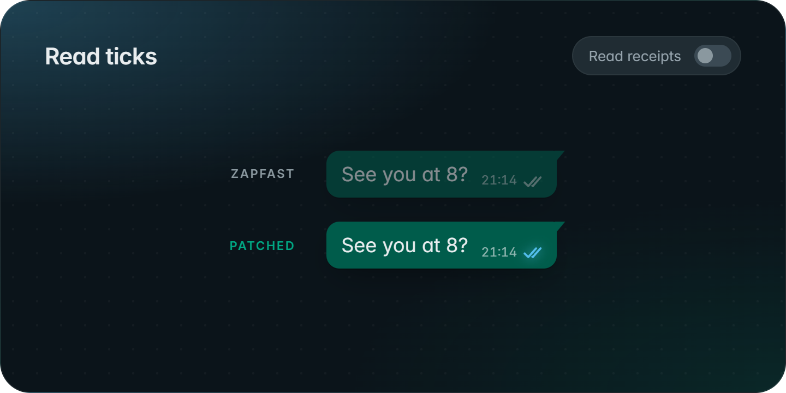
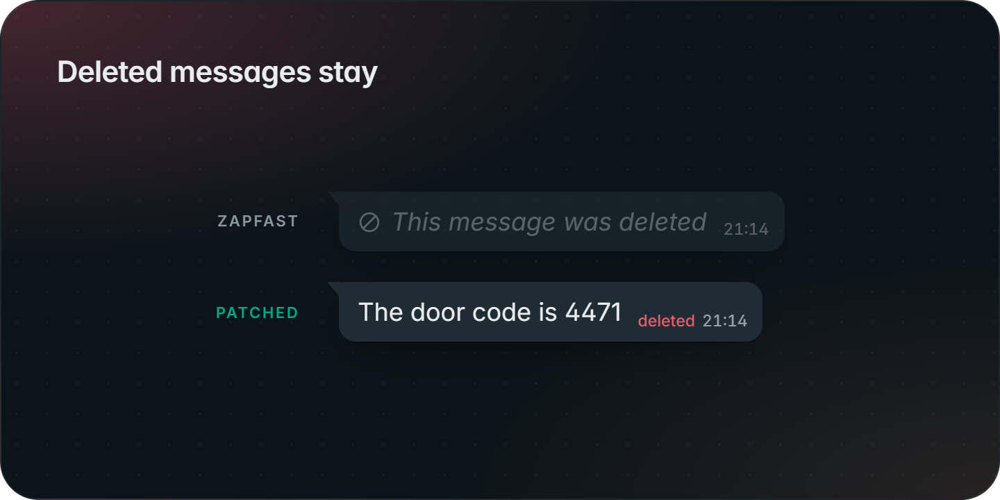
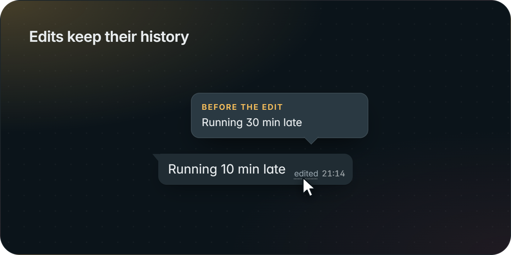
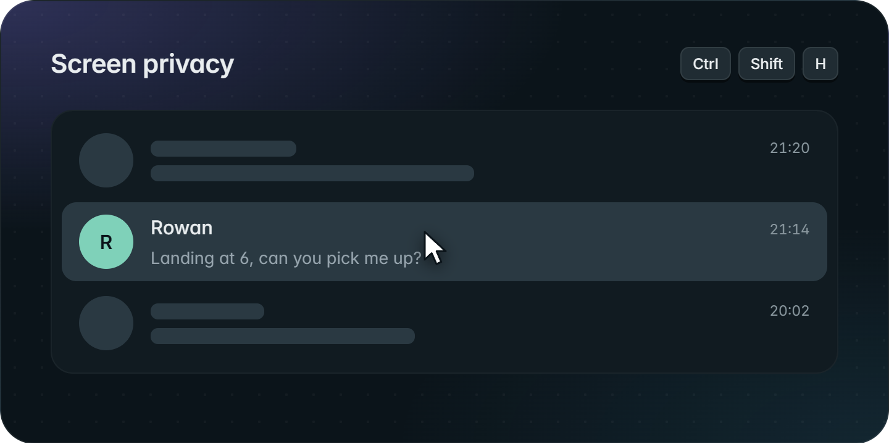
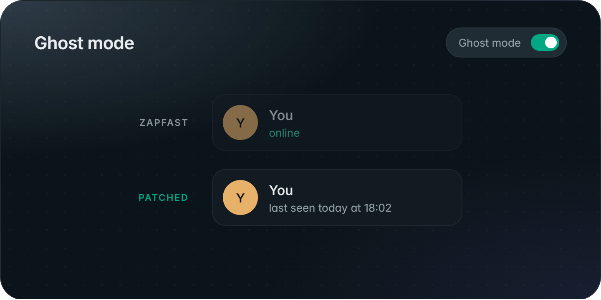
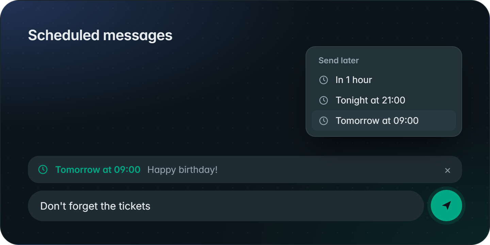
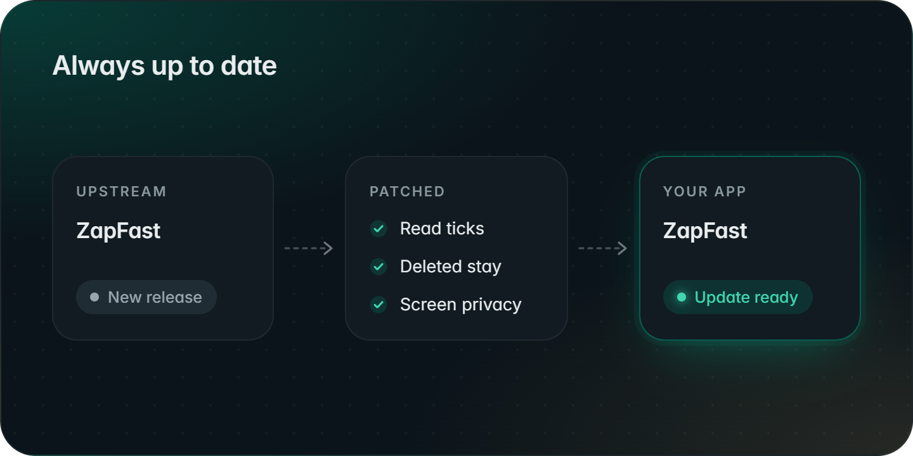

# ZapFastX

[ZapFast](https://github.com/crmne/zapfast) for Windows and macOS with a few patches on top. This isn't a separate app: every new ZapFast release is picked up, patched and published here automatically, so you get all of upstream's updates. Differences from upstream:

- **Read ticks always show**, even with your account's read receipts off.
- **Deleted messages stay.** Messages others delete for everyone are kept and marked *deleted*. Photos and voice notes download as they arrive, so deleted ones are kept too.
- **Edits keep their history.** Hover *edited* on someone's message to see what it said before.
- **Screen privacy.** Covers chats, messages, media, names and avatars until hovered (Ctrl+Shift+H, off by default). By [paulo1403](https://github.com/paulo1403) ([crmne/zapfast#451](https://github.com/crmne/zapfast/pull/451)), via [ZapFaster](https://github.com/eternalwaitt/zap-faster).
- **Ghost mode.** Never shows you as online (Settings → Privacy, off by default).
- **Scheduled messages.** Right-click Send to send later. Waiting messages sit above the composer until they go.
- **Updates come from this repository**, so they keep these changes.

  
  

  
  

  
  

  

**Also:** optional clean-up of media downloaded more than 3 months ago (Settings → Files, off by default). Media from deleted messages is always kept, by Clear too.

Everything else is upstream ZapFast. The changes are in [`patches/`](patches).

**[Download the latest release](https://github.com/Goodly58/zapfastX/releases/latest)**: `.msi` for Windows (x64 or ARM64), `.dmg` for Mac. The Mac app is unsigned, so open it the first time from System Settings → Privacy & Security → **Open Anyway**.

Unofficial build, not affiliated with ZapFast, WhatsApp or Meta. ZapFast © Carmine Paolino and contributors, [MIT](LICENSE).
